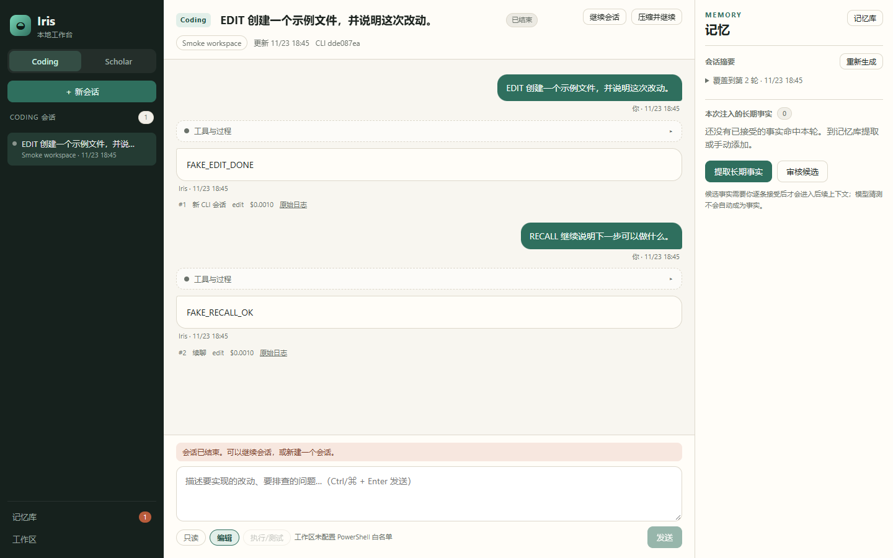
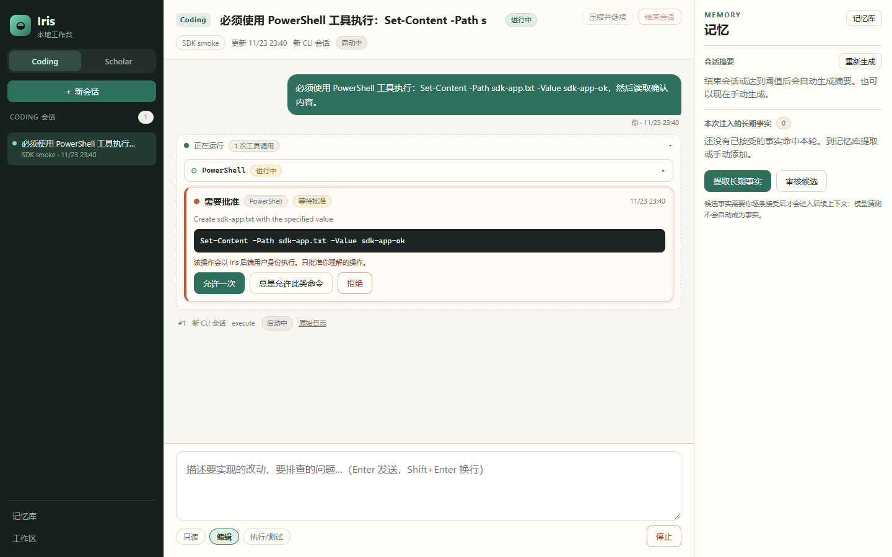
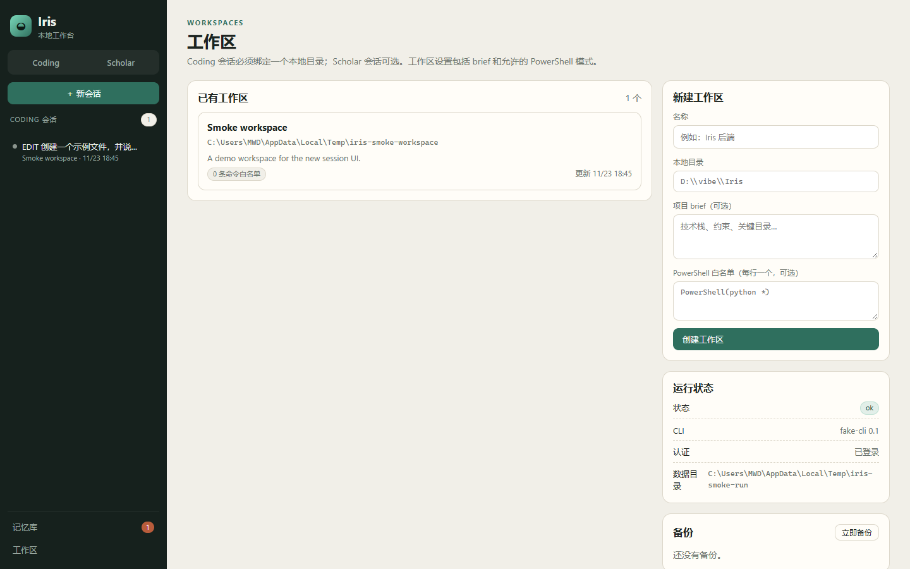

# Iris 项目概览（一页版）

> 用途：对外介绍 / 演示 / 快速理解项目现状。  
> 更新时间：2026-11-24 · 版本：v10（Session + Memory 2.0 + 双角色 + SDK 审批 + 工作区运行面板 + 系统大盘）
> 技术细节见 `README.md`、`CURRENT_PHASE.md`、`docs/roadmap.md`。

## 1. 一句话

**Iris 是一个本地优先的 AI 工作台：两个角色（Coding / Scholar）、Session 聊天、三层记忆，通过 Claude Agent SDK 驱动本机 Claude Code CLI，对需要授权的工具调用逐条审批，并让人工审核后的长期事实跨会话复用。**

它不是“又一个聊天框”，而是试图解决三个问题：

1. 一次性的对话结果，如何变成下一次可复用的上下文？
2. 原始对话、会话摘要、长期事实，如何分层保存而不互相污染？
3. 让 AI 执行本地任务时，如何保留权限边界、来源与可审计性？

## 2. 现在能做什么（演示路径）

1. 启动后打开 <http://127.0.0.1:8000>。
2. 左侧选择 **Coding** 或 **Scholar**，点「新会话」。Coding 必须选一个本地工作区。
3. 输入任务，观察增量流式文本与实时工具卡片；需要写文件或执行命令时，聊天里出现审批卡片（允许一次 / 总是允许 / 拒绝）。
4. 工作区详情页底部可以打开「运行面板」，直接启动 dev server、查看日志并停止。
5. 可以停止、继续、结束会话；结束后自动生成摘要（也可手动重新生成）。
6. 结束会话后会自动生成最多 5 个记忆候选进入收件箱；也可以在消息旁点「记住」。
7. 到「记忆库」审核候选，处理可能重复/冲突/过期；接受 / 编辑 / 拒绝。
8. 新建会话时，相关且已接受的事实会自动注入；右侧「可能相关」会在输入时提示，本次注入显示原因/分数/来源。

> 以下截图使用确定性 fake CLI 生成的演示数据，用于可重复展示；真实 CLI 的验收步骤见 `docs/acceptance/phase4-sessions.md`。

### Coding 首页


### 会话聊天：多轮、工具卡片、原始日志



### 工具审批：允许一次 / 总是允许 / 拒绝



### 记忆库：候选事实审核


### 工作区：目录、brief、命令白名单



## 3. 状态一览（2026-11-24）

| 维度 | 状态 |
|---|---|
| 版本 | schema v10；旧 Task/Run/Note 数据只读保留 |
| 角色 | Coding、Scholar 两个活动角色 |
| 会话 | 多会话；SDK 首次新 session、后续 resume；SSE 增量文本 + 工具事件 |
| 执行与审批 | Claude Agent SDK；`can_use_tool` 对需要授权的调用逐条审批；会话级 permission rules；CLI 安全只读命令可能直接执行 |
| L1 原始记忆 | 消息 + 工具调用/结果 + 每 Turn 完整 JSONL |
| L2 摘要记忆 | 阈值自动（8 Turn / 24000 字符）或会话结束；滚动累计 |
| L3 长期事实 | 自动/手动候选 → 服务端校验/去重/近似关系 → 人工审核 → 才注入；支持有效期与取代链 |
| 前端 | 三栏聊天工作台、工具卡片、审批卡片、记忆收件箱/审核、相关记忆、工作区、运行面板 |
| 运行面板 | 工作区内启动/停止长驻命令、PID/退出码、实时日志（内存 + 文件） |
| 自动化 | 70 个后端测试通过；前端构建通过；崩溃恢复脚本通过；16 条确定性记忆质量集 |
| 真实 CLI | T1–T9 全部通过：核心闭环、真实网页审批、运行面板 dev server、compact 恢复；Scholar 本地 prompt 与真实摘要通过 |
| 最小可观测 | ✅ M1 API：overview / health / errors / timeseries |
| 记忆质量 | ✅ M2 19/19；✅ Memory 2.0：自动候选、收件箱、中文/混合召回、近似合并、过期确认、16/16 确定性质量集 |
| 系统大盘 | ✅ M3 `/dashboard`：KPI、趋势、告警、记忆/工具/存储；无外部通知 |

## 4. 架构（单进程、本地优先）

```text
React + TypeScript + Vite（三栏 UI）
        │  REST + SSE（127.0.0.1）
        ▼
FastAPI（单进程）
  ├─ SessionManager       会话 / Turn / 取消 / 启动校正
  ├─ ApprovalManager      can_use_tool 挂起 → HTTP 决策 → 规则写入
  ├─ MemoryManager        摘要 / 自动候选 / 抽取 / 快速记住（单 worker）
  ├─ ProcessManager       工作区长驻命令 / 日志 / 停止进程树
  ├─ FactRepository       事实审核、作用域、去重、supersede
  ├─ SessionRepository    消息、事件、摘要、审批
  └─ Claude Agent SDK     spawn 原生 claude.exe；streaming；resume
        │
        ▼
SQLite WAL + data/session_logs/<session>/<turn>.jsonl
```

- 没有 Redis、消息队列、微服务或向量数据库。
- 单用户、本地运行；不监听公网，不保存 CLI 凭据。
- 成本/usage 来自 CLI 报告值，不是账单。
- 审批是应用层门禁，不是 OS 沙箱；批准的命令以当前用户身份执行。

## 5. 三层记忆

| 层 | 存什么 | 何时产生 | 谁能用 |
|---|---|---|---|
| L1 原始记忆 | 所有用户/助手消息、工具调用、执行结果、完整 CLI 输出 | 每次 Turn | UI 追溯；供摘要使用 |
| L2 摘要记忆 | 会话目标、完成项、决策、偏好与约束、未决问题、产出、失败教训 | 自动阈值或会话结束 | 新 CLI 会话的连续性；事实提取输入 |
| L3 长期事实 | 偏好、决策、约束、产出、洞察、未决问题、档案 | 会话结束自动候选 + 手动提取 + 聊天记住；人工审核 | 只有 accepted 才进入后续上下文 |

**安全边界**：

- 模型输出不会自动成为事实；候选必须人工接受。
- 事实、摘要、仓库内容在 prompt 中以参考数据块标注，不拼进 system prompt。
- 旧 `notes` / `global_notes` 永不注入；旧数据不迁移、不在新 UI 展示。

## 6. 两个角色

| 角色 | 用途 | 工作区 | 权限档位 |
|---|---|---|---|
| Coding | 修改代码、运行测试、交付改动 | 必须绑定 | 只读 / 编辑 / 执行（SDK 对需授权调用逐条审批；CLI 回退用白名单） |
| Scholar | 研究问题、区分 KNOWN/INFERRED/HYPOTHESIS/UNKNOWN、暴露反例与未知 | 可选 | 只读 / 研究/分析（默认不联网；`IRIS_SCHOLAR_WEB=1` 可启用 Web） |

角色是**策略层**：行为、工具权限、上下文策略的组合；不是独立 Agent、模型或记忆库。

审批规则是**会话级**：PowerShell 按命令前缀、Write/Edit 按文件路径、其他工具按精确输入；“总是允许”写入 `permission_rules`，新会话重新请求。

**审批边界**：Claude Code 会在触发 `can_use_tool` 之前直接放行部分只读/安全命令（实测 `echo`、`Get-Date`、`Start-Sleep`），因此不是所有 shell 调用都会在 Iris 弹卡；写文件、未知命令与 `python` 等仍逐条审批。

## 7. 质量与验证

- **自动化**：`pytest backend/tests -q` → 70 个测试通过；`npm run build` 通过；`scripts/memory_eval.py` 16 条确定性查询 recall/precision/abstain 1.0、stale 0。
- **Memory 2.0**：真实 SDK R1–R6 通过——自动候选、跨会话召回、中文/abstain、近似重复取代、过期确认、右侧可能相关。
- **审批**：允许/拒绝/总是允许/超时/取消与规则匹配有单测；本机 `claude.exe` + CC Switch/DeepSeek 下真实验证过 PowerShell 审批、文件生成与 resume；T7 用无头 Edge 在真实网页完成允许一次/拒绝/总是允许/规则复用/超时。
- **运行面板**：T8 在真实网页启动 Python dev server，验证日志、HTTP 200、停止与删除工作区后的端口/PID 清理。
- **compact**：T9 在真实 resume 失败后通过网页「压缩并继续」重建 CLI 会话，后续 Turn 成功并注入摘要。
- **可靠性**：`scripts/crash_test.py` 验证强杀后端后 CLI 子进程被清理，重启后 Turn 校正为 `interrupted`。
- **并发**：同一 Session 一个活动 Turn；同一工作区一个活动 Coding Turn（DB 部分唯一索引兜底）。
- **可追溯**：每次 Turn 保存注入事实清单、字符数、是否注入摘要；审批记录写入 `turn_approvals`；原始日志可下载。
- **Scholar**：默认本地 prompt-first（不联网）；Web 模式历史验收通过，需显式开启。
- **M0**：T1–T9 全部通过；已知边界是 CLI 会自动放行部分安全只读命令，不弹 Iris 审批。

## 8. 当前限制（介绍时建议主动说明）

- 单用户、本地、单进程；无登录/远程访问/多 worker。
- 审批不是沙箱；SDK 可能加载用户级 hooks/插件，工作区必须可信。
- Claude Code 对安全只读命令（如 `echo`、`Get-Date`、`Start-Sleep`）会直接放行，不触发 Iris 审批；当前没有强制全部 shell 调用弹卡的机制。
- “总是允许”规则目前是会话级，没有 UI 管理/清除。
- 运行面板不经过审批，也不是沙箱；进程记录只在内存，后端重启会停止进程并清空列表。
- Scholar 的多子任务深度研究编排（旧 `research_jobs`）本轮未接入新 UI。
- 检索仍是预分词 FTS5 + 关键词/别名/标签 + 排序，不做 embedding；同义改写可能漏。
- 摘要/事实提取需要额外 CLI 调用，会产生成本；默认单 worker 串行；会话结束自动候选会增加一次抽取成本。
- 事实提取质量取决于模型；必须人工审核；近似重复/冲突为确定性建议，语义矛盾仍可能漏。
- `valid_until` 由用户设置；过期事实不注入，但不会自动判定内容真假。
- 旧 tasks/runs/notes 数据不迁移、不展示。
- 大盘告警只在页面内展示，不发外部通知；rollups 只覆盖 Turn/成本/工具/拒绝；记忆/存储趋势仍用窗口聚合。

## 9. 下一步路线（摘要）

| 里程碑 | 内容 |
|---|---|
| **M0 真实验收** | ✅ T1–T9：核心闭环、真实网页审批、运行面板 dev server、compact 恢复、Scholar、真实摘要与阻塞修复 |
| **M1 最小可观测** | ✅ Token/耗时/成功率/健康/错误 API；暂不做告警 |
| **M2 记忆质量** | ✅ 19/19 案例通过（真实 SDK） |
| **Memory 2.0** | ✅ 自动候选/收件箱/聊天记住/中文混合检索/近似合并/过期确认；R1–R6 真实通过 |
| **M3 全局大盘** | ✅ rollups + `/dashboard`：健康、活动、成本、记忆、存储 |
| **M4 Scholar 深度** | 14 题盲评：Scholar 12 / Coding 2；校准/反方优势明显，correctness 略低；成本 +5.5%、耗时 +10.5%；暂不进入编排 |
| **M5 体验** | 通知、会话搜索、导出、移动端 |

完整内容见 `docs/roadmap.md`。

## 10. 三分钟介绍脚本（可直接用）

1. **30 秒定位**：Iris 不是聊天工具，而是把“执行 → 原始记录 → 会话摘要 → 审核后的长期事实”串起来的本地工作台。
2. **60 秒演示**：打开 Coding → 新会话 → 发任务 → 工具卡片 → 审批卡片允许一次 → 结束会话自动生成候选 → 收件箱接受/合并 → 新会话看到“可能相关”和事实注入。
3. **60 秒讲架构**：两个角色 + Session/Turn；三层记忆 + 预分词 FTS/阈值/收件箱；SDK 执行 + 需授权调用逐条审批；SQLite + JSONL；权限档位与并发锁。
4. **30 秒讲现状**：70 个测试、构建与崩溃恢复通过；M0 T1–T9、Memory 2.0、本地 Scholar 与摘要通过；M1 可观测、M2 记忆 19/19、M3 系统大盘已实现；M4 14 题盲评 Scholar 12 / Coding 2，暂不进入研究编排；下一步人类盲评与体验。

## 11. 在哪里看

| 想看什么 | 去哪里 |
|---|---|
| 项目定位、启动、配置、限制 | `README.md` |
| 当前阶段与验收状态 | `CURRENT_PHASE.md` |
| 后续方向、可观测计划、全局大盘设计 | `docs/roadmap.md` |
| Session/三层记忆决策 | `docs/decisions/0006-session-memory.md` |
| SDK 执行与审批决策 | `docs/decisions/0007-agent-sdk-approvals.md` |
| 指标 rollups 与大盘决策 | `docs/decisions/0008-metrics-rollups-dashboard.md` |
| Scholar 本地 prompt-first 决策 | `docs/decisions/0009-scholar-local-prompt.md` |
| M0 验收矩阵（T1–T9） | `docs/acceptance/m0-real-cli.md` |
| M1 可观测验收 | `docs/acceptance/m1-observability.md` |
| M2 记忆案例集 | `docs/evaluation/memory-benchmark.md` |
| Memory 2.0 验收 | `docs/acceptance/memory-2.0.md` |
| 主流记忆方案调研 | `docs/evaluation/memory-landscape.md` |
| Memory 2.0 决策 | `docs/decisions/0010-memory-2.md` |
| 真实 SDK 验收步骤 | `docs/acceptance/phase4-sessions.md` |
| 演示截图 | `docs/assets/overview-*.png` |
| M3 大盘验收 | `docs/acceptance/m3-dashboard.md` |
| M4 Scholar 试点 | `docs/evaluation/scholar-incremental.md` |
| 实际界面 | 启动后访问 <http://127.0.0.1:8000>；页面包括 `/:role`、`/:role/:sessionId`、`/dashboard`、`/memory`、`/workspaces` |

启动方式：双击仓库根目录 `start.bat`，或：

```powershell
cd D:\vibe\Iris
.\.venv\Scripts\python.exe -m uvicorn app.main:app --app-dir backend --host 127.0.0.1 --port 8000
```
